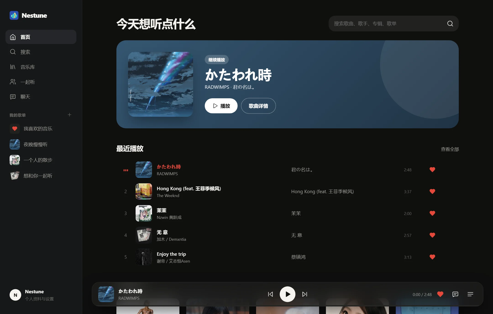

# Nestune

一个属于你的音乐空间。在线听歌、管理歌单和自己的音乐，也可以邀请朋友一起听、边听边聊。

[开始体验](https://music.0use.net/) · [项目介绍](https://0use.net/Nestune/) · [下载 V1.0.0](https://github.com/0use-TE/Nestune/releases/tag/v1.0.0)

测试账号：`test` · 密码：`W1111111`

| Folder | What |
|---|---|
| `web/` | **Current app.** Next.js: player UI + backend API + admin panel. See `web/README.md`. |
| `audio-worker/` | NCM decrypt / MP3 transcode container. Deployed on the NAS (see below). |
| `prototype/` | Static HTML mock-ups used to agree on the visual style. |
| `clients/` | Tauri desktop clients for Windows, Linux and macOS, plus packaging scripts. See `clients/README.md`. Android includes the native media service and keyboard/back integration. |
| `docs/` | Static project website. GitHub Actions deploys it to GitHub Pages when this folder changes on `main`. |

## V1.0.0



- 搜索与播放歌曲、专辑和歌单，沉浸播放器与歌词、可管理的播放队列。
- 分别收藏歌曲、专辑和歌单，创建、分享自己的歌单，上传自己的音乐。
- 好友聊天、歌曲与公开歌单分享、一起听邀请和双方共同管理的队列。
- 浏览器 / PWA，以及 Windows、macOS、Linux 和 Android 客户端。
- Android 系统媒体信息与控制、返回键处理、键盘适配；设置中检查更新。

| 平台 | 下载 |
| --- | --- |
| Windows x64 | [安装版](https://github.com/0use-TE/Nestune/releases/download/v1.0.0/Nestune-1.0.0-Windows-x64-Tauri-Setup.exe) · [便携版](https://github.com/0use-TE/Nestune/releases/download/v1.0.0/Nestune-1.0.0-Windows-x64-Tauri.exe) |
| macOS Universal | [DMG](https://github.com/0use-TE/Nestune/releases/download/v1.0.0/Nestune-1.0.0-macOS-universal.dmg) · [App ZIP](https://github.com/0use-TE/Nestune/releases/download/v1.0.0/Nestune-1.0.0-macOS-universal.app.zip) |
| Linux x86-64 | [AppImage](https://github.com/0use-TE/Nestune/releases/download/v1.0.0/Nestune-1.0.0-Linux-x64.AppImage) · [DEB](https://github.com/0use-TE/Nestune/releases/download/v1.0.0/Nestune-1.0.0-Linux-amd64.deb) |
| Android 7+ | [通用 APK](https://github.com/0use-TE/Nestune/releases/download/v1.0.0/Nestune-1.0.0-Android-Tauri.apk) |

客户端连接在线服务；网页功能更新无需重新打包。安装、系统依赖及签名说明见 [clients/README.md](clients/README.md)。[SHA-256 校验文件](https://github.com/0use-TE/Nestune/releases/download/v1.0.0/SHA256SUMS.txt) · [更新记录](CHANGELOG.md)

展示截图来自当前产品，个人收藏及聊天使用演示内容。

## Run locally

```powershell
cd web
npm install
copy .env.example .env.local   # set ADMIN_KEY
npm run dev
```

## audio-worker on the NAS

Runs from `/vol1/opt/docker/nestune` on the Fnos box (`compose.yaml` = `audio-worker/compose.nas.yaml`, `.env` holds `WORKER_KEY`).
Port 4191 is published on the LAN and protected by `WORKER_KEY`; `/health` is open. Folders: `storage/incoming` (input, read-only), `storage/music` (output), `audio-worker/state` (queue DB).

```sh
cd /vol1/opt/docker/nestune
docker compose ps
docker compose logs --tail 30
docker compose up -d --no-build --pull never
```
