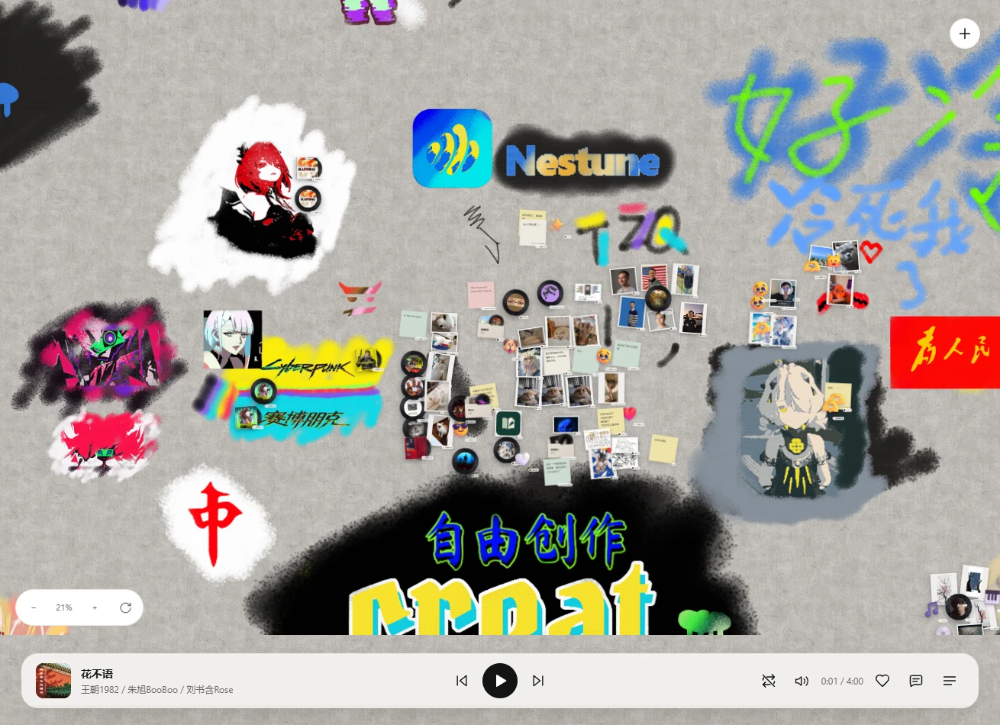
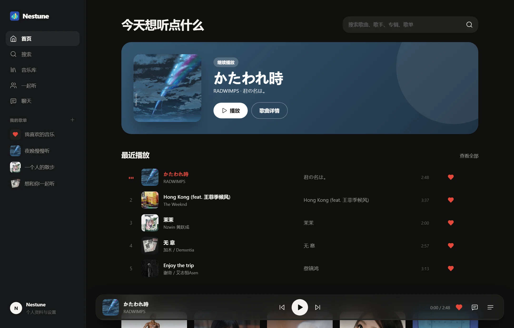
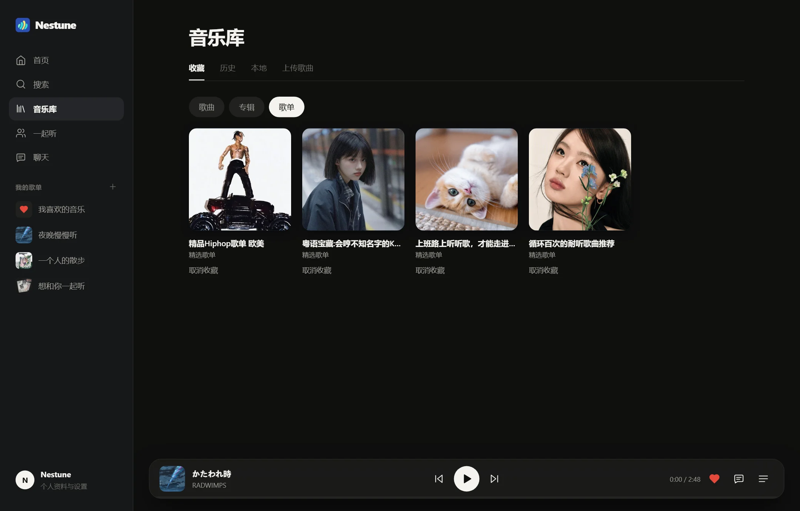
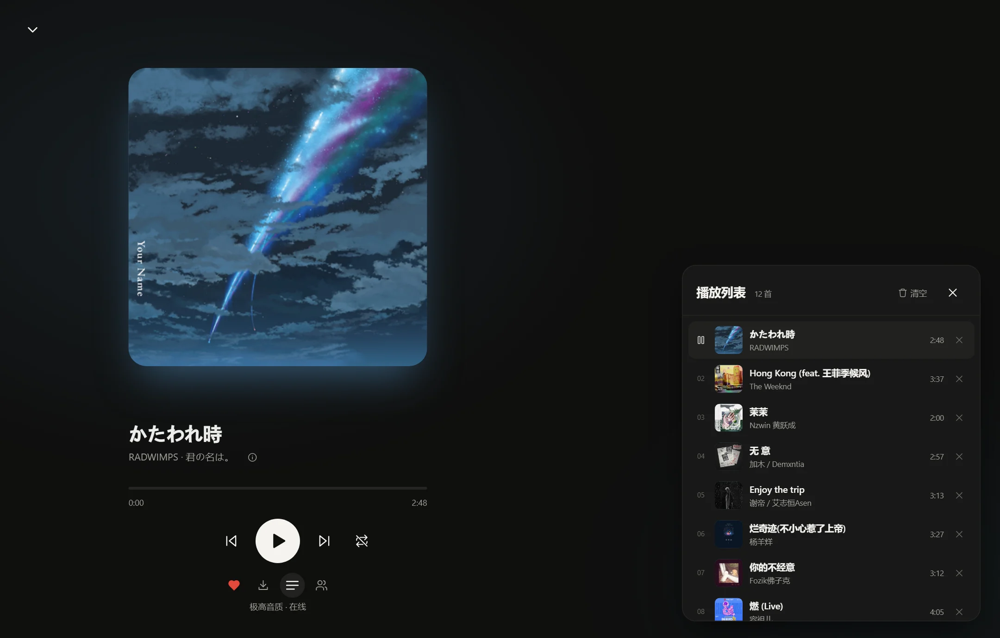
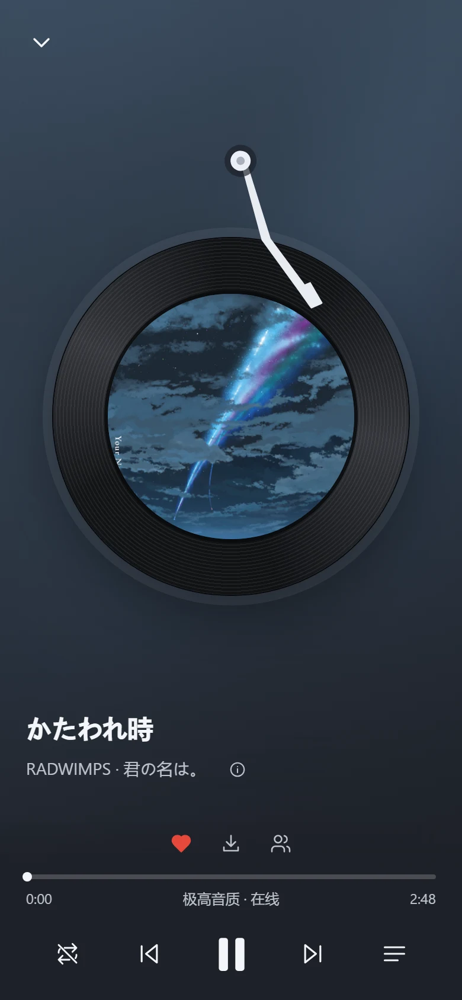
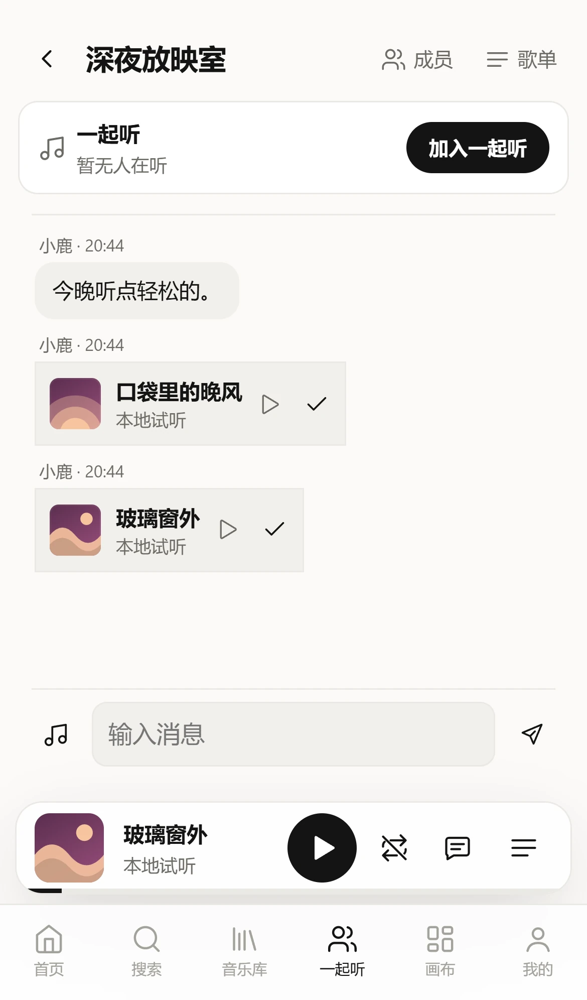
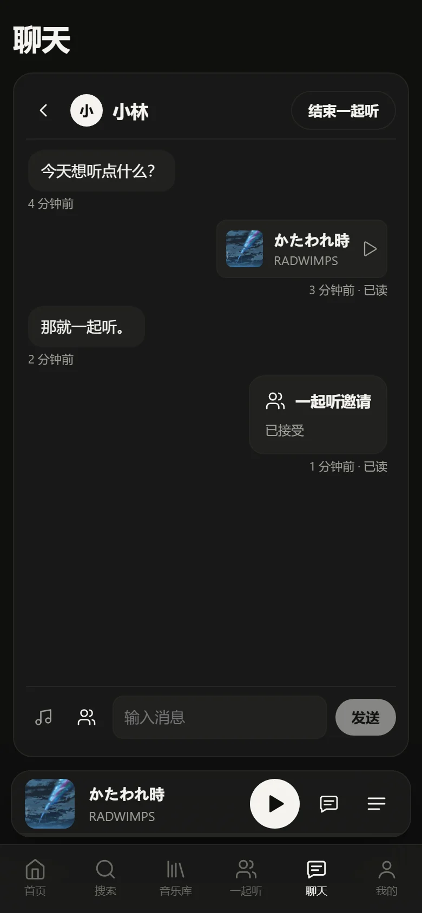

# Nestune

一个可以和朋友一起听歌、也可以一起画画的音乐空间。

[在线体验](https://nestune.0use.net:8443/) · [下载客户端](https://nestune.0use.net:8443/downloads) · [项目介绍](https://0use.net/Nestune/)

测试账号：`test` · 密码：`W1111111`

## 共享画布

这是 2026 年 11 月 24 日的线上画布。墙上的涂鸦、便签、图片和唱片都由大家放上去。长按一张唱片拖到底部，就能把墙上的歌放进播放队列。

[](https://nestune.0use.net:8443/square)

## 听歌与收藏

| 首页 · 从推荐开始听 | 音乐库 · 找回收藏的专辑 |
| --- | --- |
|  |  |

播放歌曲时可以展开沉浸播放器，查看接下来要听的歌。手机上也可以切换到唱片视图。



## 和朋友一起听

在「一起听 → 域」里邀请好友。在线好友优先显示，大家可以在群聊里点歌、把歌加入域歌单，再加入同步播放。退出同步后，聊天记录和歌单仍然保留。

| 手机播放器 | 域群聊 | 好友聊天 |
| --- | --- | --- |
|  |  |  |

## 音源与平台

- **网易云音乐、QQ 音乐**：一次搜索即可查找两个平台的歌曲。同一录音有多个来源时，可以选择优先音源，也可以在播放中切换并保留进度。
- **本地音乐**：可以播放设备上的音频文件，也可以上传到自己的音乐库，在其他设备上登录收听。

| 平台 | 使用方式 |
| --- | --- |
| Android | 安装 APK |
| iPhone、iPad | 用 Safari 打开网页版，在分享菜单中选择「添加到主屏幕」 |
| Windows | 安装桌面客户端，或使用便携版 |
| macOS | 安装通用版 DMG，支持 Intel 和 Apple 芯片 |
| Linux | 使用 AppImage 或 DEB 包 |
| 网页 | 在浏览器中直接打开，支持 PWA |

[打开网页版](https://nestune.0use.net:8443/) · [下载各平台客户端](https://nestune.0use.net:8443/downloads)

## 让 AI 帮你部署

把下面这段复制给能操作终端的 AI 助手：

```text
帮我部署 Nestune：https://github.com/0use-TE/Nestune
请先阅读仓库首页和 web/README.md，根据我的系统配置并启动服务，保留已有数据。部署完成后检查 /api/health，告诉我访问地址，以及如何创建第一个账号和配置音乐源。
```

<details>
<summary>1.2.1 历史功能与安装包</summary>

- 搜索与播放歌曲、专辑和歌单，沉浸播放器与歌词、可管理的播放队列。
- 分别收藏歌曲、专辑和歌单，创建、分享自己的歌单，上传自己的音乐。
- 好友聊天、歌曲与公开歌单分享、一起听邀请和双方共同管理的队列。
- 浏览器 / PWA，以及 Windows、macOS、Linux 和 Android 客户端。
- Android 系统媒体信息与控制、返回键处理、键盘适配；设置中检查更新。
- 共享画布可放置唱片、专辑、歌单、便签与图片，拖到底部追加播放队列。
- 我的歌单支持一键或拖动整单入队，保留当前播放进度。
- 播放器音量、静音和记忆设置；Windows 与 Android 系统悬浮歌词。
- 播放与下载权限分开判断，连接错误提供错误码和请求编号。
- 网易云与 QQ 音乐双源搜索、同录音合并，支持优先音源和保留进度的手动切换。
- 逐字歌词以蓝黄流光扫色，每句随机配色路径；支持播放器、应用内浮窗和浏览器画中画。
- Windows/安卓 1.2.1 已发布，系统浮窗支持流光歌词（安卓 code 7），入口使用 `nestune.0use.net:8443`。
- 歌手完整曲库一键播放；Windows 歌词锁定位置后仍可解锁、切换背景和关闭。

| 平台 | 下载 |
| --- | --- |
| Windows x64 · 1.2.1 | [安装版](https://nestune.0use.net:8443/api/client-updates/windows/121) · [便携版](https://nestune.0use.net:8443/downloads/files/Nestune-1.2.1-Windows-x64-Tauri.exe) |
| macOS Universal · 1.2.1 | [DMG](https://nestune.0use.net:8443/downloads/files/Nestune-1.2.1-macOS-universal.dmg) · [App ZIP](https://nestune.0use.net:8443/downloads/files/Nestune-1.2.1-macOS-universal.app.zip) |
| Linux x86-64 · 1.2.1 | [AppImage](https://nestune.0use.net:8443/downloads/files/Nestune-1.2.1-Linux-x64.AppImage) · [DEB](https://nestune.0use.net:8443/downloads/files/Nestune-1.2.1-Linux-amd64.deb) |
| Android 7+ · 1.2.1 | [通用 APK](https://nestune.0use.net:8443/api/client-updates/android/7) |

客户端连接在线服务；网页功能更新无需重新打包，系统悬浮歌词需安装新版 Windows 或 Android 客户端。安装、系统依赖及签名说明见 [clients/README.md](clients/README.md)。[1.2.1 安装包校验](docs/releases/v1.2.1.md) · [下载与历史版本](https://nestune.0use.net:8443/downloads) · [更新记录](CHANGELOG.md)

</details>

## 仓库目录

| Folder | What |
|---|---|
| `web/` | **Current app.** Next.js: player UI + backend API + admin panel. See `web/README.md`. |
| `audio-worker/` | NCM decrypt / MP3 transcode container. Deployed on the NAS (see below). |
| `prototype/` | Static HTML mock-ups used to agree on the visual style. |
| `clients/` | Tauri desktop clients for Windows, Linux and macOS, plus packaging scripts. See `clients/README.md`. Android includes the native media service and keyboard/back integration. |
| `docs/` | Static project website. GitHub Actions deploys it to GitHub Pages when this folder changes on `main`. |

## Run locally

```powershell
cd web
npm install
copy .env.example .env.local   # set ADMIN_KEY
npm run dev
```

## audio-worker on the NAS

Runs from `/vol1/opt/docker/nestune` on the Fnos box (`compose.yaml` = `audio-worker/compose.nas.yaml`, `.env` holds `WORKER_KEY`).
Port 4191 is published on the LAN and protected by `WORKER_KEY`; `/health` is open. Folders: `storage/incoming` (input, read-only), `storage/music` (output), `audio-worker/state` (queue DB).

```sh
cd /vol1/opt/docker/nestune
docker compose ps
docker compose logs --tail 30
docker compose up -d --no-build --pull never
```

不小心做成绘画软件了（误）
