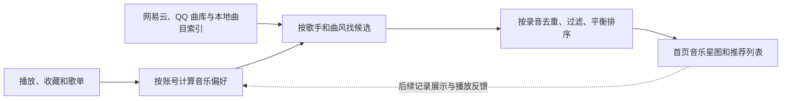

# Nestune 个性化推荐技术与部署方案

日期 2026-11-26。面向负责实现、测试和发布 Nestune 的开发与运维人员。

第一阶段上线首页「音乐星图」和「为你推荐」。用 Nestune 自己的听歌历史、收藏和歌单计算每个账号的音乐偏好，再从已接入音源找候选歌曲。沿用现有 Next.js、Node.js 24、SQLite 和 Docker Compose。音源提供曲库，Nestune 决定给哪个账号推荐什么。

**交接状态。** 核对基线为 `main@28b3355`。工作区 `feat/taste-constellation-preview` 已有可验证的音乐星图预览，包含尚未提交的文件。主分支当前没有这套功能。先把预览整理成经过审查的提交，完成下列发布条件后再切换生产。拿到文档本身即可部署的成品镜像尚未生成。

## 一、参考架构与选型



大型平台使用事件队列、流处理和数据仓库接收行为，再用批量训练和在线特征更新支持推荐。Spotify 公开过 Pub/Sub、Flink 或 Dataflow、BigQuery 的数据平台，也公开过按约半年、一个月、一周汇总音频和歌单共现特征、用自编码器生成用户向量的方案。网易云音乐的 PIANO 论文披露了音乐**搜索**的匹配、排序和重排流程。这些资料用来参考分层方式，厂商的模型和指标各自对应具体场景。 [Spotify 数据平台](https://engineering.atspotify.com/2024/05/data-platform-explained-part-ii) · [Spotify 用户向量](https://research.atspotify.com/2025/9/generalized-user-representations-for-large-scale-recommendations) · [网易云音乐 PIANO](https://arxiv.org/abs/2606.16641)

曲库特征还可以单独建设。Pandora 的 Music Genome Project 让音乐分析师标注曲目的音乐属性，可作为按内容相似度找歌的参考。Nestune 第一阶段用现有音源的歌手和曲风字段，用 SQLite 聚合行为、TypeScript 排序、进程内缓存曲库查询。用线上延迟、上游调用量和推荐质量决定何时引入批量计算、模型或独立服务。 [Pandora Music Genome Project](https://pandora.com/about/mgp)

### Nestune 第一版选型

采用**基于内容的个性化推荐**。SQLite 读取每个账号的播放、收藏与歌单记录，TypeScript 计算带时间衰减的歌手和曲风偏好，从本地索引和已接入的音乐服务召回曲目，按录音去重后在多个兴趣中心之间轮流取歌。收藏比一次开始播放更能表达偏好。刚加入的账号也可以通过收藏或建立歌单生成第一张星图。实现沿用 Next.js、Node.js 24 和现有 NAS 上的 SQLite、Docker Compose。

浏览器用 React 的原生按钮承载画布已有的黑胶唱片、专辑封套和歌单文件夹，SVG 绘制节点间的连线。主页顶部下拉展开星图，单曲和最多六张专辑同图显示。拖动物件可重新摆放，鼠标停稳约 480 毫秒才突出关联。Pointer Events 处理拖动和双指缩放，滚轮以光标为中心缩放，点击节点后镜头定位并打开详情。前端复用画布的缩放坐标计算，支持键盘和系统减少动态效果设置。以目前每张图最多 60 首的规模，以上交互均在浏览器本地完成。

后续先采集可区分主动跳过、听完与播放失败的反馈。积累足够的多账号共听样本后，再离线试验 ItemCF，以跨歌手发现、有效收听率和主动短跳率与本方案比较，作为是否增加第二种召回方式的依据。

## 二、第一版的实现与数据流

| 项目 | 工作区预览的行为 |
| --- | --- |
| 画像输入 | 仅查当前账号最近最多 240 条收藏、400 条播放记录和 240 条自有歌单直接收录。记录按已知录音身份聚合。设备歌曲、用户上传歌曲及明确不可播记录不参与画像 |
| 计算权重 | 收藏权重 6，歌单收录 3，播放 1。每条行为按 `权重 / (1 + 记录距今天数 / 90)` 衰减，再将单录音总分封顶为 15。分数分配给关联歌手和经过音源确认的曲风 |
| 兴趣节点 | 最多 6 个歌手或曲风节点，其中曲风最多 3 个。用最多 4 首网易云种子查曲风，优先覆盖不同歌手。曲风元数据缺失时仍可按歌手生成 |
| 候选歌曲 | 已有音乐记录、`music_sources` 最近最多 640 条在线曲库记录，以及按兴趣节点查询的网易云或已配置 QQ 曲库。按已知录音身份去重，滤掉已知不可播的来源 |
| 展示顺序 | 先在各兴趣节点间轮转，再优先选取没有播放记录的录音。中心歌单目标 36 首，图中最多 60 首。个性化新曲不足时从公开新歌和本地在线曲库补充，归入「曲库探索」。图里可以保留已听过的歌来解释兴趣来源 |
| 等待与降级 | 每次外部曲库查询最多等 1.6 秒后继续处理本地结果。网易云曲风和候选请求自身超时为 1.5 秒。曲库结果进程内缓存约 15 分钟，失败结果约 30 秒；QQ 请求可能在页面停止等待后继续执行 |

「未听」按账号的已播放歌曲索引判断。首次升级从现存历史回填，此后历史列表滚动清理时仍保留已听标记，用户主动清除历史会同步清除标记。已识别的跨音源版本按录音归并。第一版的播放记录在开始播放时写入，不能据此判断有效听时、听完率或主动跳过。曲库权限随音源账号和版权状态变化，播放时仍由现有播放器验证实际权限。

| 接口和代码 | 职责 |
| --- | --- |
| `GET /api/me/taste-map` | 登录后从会话取得用户 ID。返回 `centers[]`、`tracks[]` 和 `mixIds[]`。每首歌可带关联兴趣与推荐理由。无偏好时从公开曲库开始，曲库也无可用候选时返回空列表 |
| `web/src/server/taste-map.ts` | SQL 聚合、兴趣计算、候选查找、去重和排序 |
| `web/src/lib/taste-map.ts` | 画像结果与选择状态的数据类型 |
| `web/src/components/PersonalTasteAtlas.tsx` | 首页请求、加载与空态、重试、接入现有播放器。账号切换时取消旧请求，按账号隔离组件状态 |
| `/taste-map-preview` | 使用示例数据的设计预览。生产发布应省略该路由或将其限制在测试环境 |

个性化响应沿用账号接口的 `Cache-Control: no-store`。反代、CDN 和 Service Worker 不应缓存它。跨账号可共享的是按歌曲、歌手或曲风检索的曲库结果。用户画像按当前会话单独计算。音源会话凭据留在服务端，接口与日志不输出凭据、原始用户收藏或听歌明细。

## 三、发布条件与验收

1. **整理发布提交。** 检查当前分支的首页和音源适配变更，以及未跟踪的星图组件、样式、接口、类型和测试。把功能提交合入待发布基线。从该提交构建，记录提交 SHA 和镜像 ID。
2. **补开关与灰度。** 现有预览尚无发布开关。建议用服务端 `TASTE_MAP_ENABLED`，默认关闭，配合测试账号白名单做灰度。接口和首页都服从同一开关。关闭时首页隐藏星图并保持其他内容可用。开关进入 Compose 之前不能靠设置同名环境变量关闭功能。暂未补开关时，把当前预览留在隔离环境。
3. **确认降级与开销。** 在隔离数据目录中模拟网易云或 QQ 迟滞、错误和空结果。记录接口耗时、错误率、每次请求的上游调用数及缓存命中率。特别检查 QQ 请求在并发冷缓存下的实际超时；若后台请求堆积，给推荐路径增加上游超时与并发限制再发布。
4. **用测试账号走完整链路。** 用两个偏好明显不同的账号和一个空白账号。确认结果有差异，登出或切换账号后不会看到前一个账号的画像，空白账号能探索公开曲库，音源不可用且本地无候选时显示引导。验证网易云与 QQ 已识别的同一录音只出现一次，私有上传不会出现在推荐里，单曲和整组都能走现有播放流程。

| 验收项 | 检查方法 |
| --- | --- |
| 本地构建 | Node.js 24 下运行 `npm ci`、`npm test`、`npx tsc --noEmit`、`npm run build`。工作区当前 248 项测试和类型检查通过，发布提交需重跑并验证生产构建 |
| 鉴权和缓存 | 未登录访问画像接口应返回 401。登录请求检查响应不可共享缓存。账号 A 收藏某首歌后，账号 B 的画像不应出现来自 A 的行为 |
| 列表 | 候选充足时推荐 36 首，推荐 ID 都能在响应的曲目中找到。验证已知不可播和跨平台录音去重，以及同一歌手的展示密度 |
| 性能 | 冷缓存和热缓存分别采样。可先把隔离环境冷缓存 p95 ≤ 4 秒作为验收目标，实际阈值根据 NAS 基线校准。上游故障时星图降级，首页其他内容可用 |
| 网页端与移动端 | 继续播放、历史、榜单正常。手机可操作星图、滚动列表、启动播放。检查当前主线版本的安装客户端重新打开后加载正确的网页 |

## 四、NAS 发布与回滚

现有生产 Web 工作目录为 `/vol1/opt/docker/nestune/web`，Compose 文件为 `compose.nas.yaml`。SQLite 和运行数据都挂载在 `./data:/app/data`，Docker 网络为 `nestune_default`。Web 启动时在事务中创建 heard_songs，回填现存历史，并注册 SQLite 触发器以同步后续播放。客户端沿用现有版本。

1. 在 NAS 暂存目录放置已审查提交的 `web/` 构建上下文。保持生产 `.env`、音源会话和 `data/` 在服务端。切换前对 SQLite 做一致性备份，使用 SQLite 在线备份接口或 `.backup`；生产运行时直接复制 `app.db` 可能遗漏 WAL 中的写入。保留当前 Web 镜像和运行配置。
2. 用新的镜像标签构建候选。按现有 NAS 发布流程启动仅绑定回环地址的预检容器，挂载独立的测试数据目录，创建测试账号并执行上表。禁止将生产 `data/` 挂载给预检容器。音源连通性使用已有受控测试环境验证，只记录结果，不复制凭据到发布包。
3. 预检通过后，核对线上容器和配置仍对应备份时的版本。将候选镜像登记为 Compose 现有 Web 镜像标签，只更新 Web 服务。保留现有数据库挂载、反代、QQ 音乐和音频 worker。

先在 NAS 构建候选。`STAGED_WEB` 替换为候选构建上下文的真实路径，`RELEASE_SHA` 替换为待发布提交的短 SHA。后续命令使用相同的 Shell 变量。

```sh
set -eu
STAGED_WEB='/path/to/reviewed/staged/web'
RELEASE_SHA='<short-commit-sha>'
CANDIDATE="nestune-web:taste-map-${RELEASE_SHA}"
ROLLBACK="nestune-web:before-taste-map-${RELEASE_SHA}"
docker build -t "$CANDIDATE" "$STAGED_WEB"
```

启动隔离预检。`QA_DATA` 指向新建的绝对路径，由容器 UID 1000 可写。`QA_ENV` 指向仅含测试配置的服务端文件，包含独立的至少 32 字符 `ADMIN_KEY` 和已实现的灰度开关设置。需要验证 QQ 候选时再配置测试环境的 QQ API 地址。使用 SSH 转发访问回环端口，在管理页创建测试账号；注册和登录按现有流程走。

```sh
QA_DATA='/path/to/isolated/taste-map-qa-data'
QA_ENV='/path/to/isolated/taste-map-qa.env'
QA_NAME="nestune-taste-map-qa-${RELEASE_SHA}"
test -d "$QA_DATA"
test -f "$QA_ENV"
docker run -d --name "$QA_NAME" --network nestune_default \
  -p 127.0.0.1:13043:3000 --env-file "$QA_ENV" \
  --mount "type=bind,src=$QA_DATA,dst=/app/data" "$CANDIDATE"
docker logs "$QA_NAME"
# 等容器启动后检查，再按验收表执行登录与播放测试。
curl -fsS http://127.0.0.1:13043/api/health
```

**预检通过后才执行下面的生产切换。** 先核对生产源码与 Compose 配置、完成一致性备份。若发布提交新增了 Compose 中的开关配置，按审查后的配置更新生产文件，再执行切换命令。

```sh
cd /vol1/opt/docker/nestune/web
OLD_CONTAINER="$(docker compose -f compose.nas.yaml ps -q web)"
test -n "$OLD_CONTAINER"
ACTIVE_TAG="$(docker inspect -f '{{.Config.Image}}' "$OLD_CONTAINER")"
OLD_IMAGE="$(docker inspect -f '{{.Image}}' "$OLD_CONTAINER")"
test "$ACTIVE_TAG" = 'nestune-web:0.1.0'
docker image tag "$OLD_IMAGE" "$ROLLBACK"
test "$(docker compose -f compose.nas.yaml ps -q web)" = "$OLD_CONTAINER"

docker image tag "$CANDIDATE" "$ACTIVE_TAG"
docker compose -f compose.nas.yaml up -d --no-build --no-deps --force-recreate web
docker compose -f compose.nas.yaml ps web
```

容器健康后，检查 `/api/health`、`/api/version` 和首页。通过公网入口用白名单测试账号复验星图与播放，查看 Web 日志有无异常 5xx 和持续超时。先开放给测试账号，再逐步扩大。记录发布提交、镜像标签、原镜像标签、数据库备份路径和回滚结果。生产构建目录若还用于后续 Compose 重建，将本次已审查的源码增量同步进去，避免以后从旧源码重建覆盖修复。

如果推荐异常，先关闭已部署的服务端开关。首页、鉴权或播放出现回归时回滚镜像。若本次同时修改了 Compose 配置，先恢复对应配置，再在生产目录执行下面的命令并复验。镜像回滚继续挂载原 `data/`，保留上线后用户产生的新数据。确认预检已结束后，用 `docker rm -f "$QA_NAME"` 停止和移除预检容器。

```sh
docker image tag "$ROLLBACK" "$ACTIVE_TAG"
docker compose -f compose.nas.yaml up -d --no-build --no-deps --force-recreate web
docker compose -f compose.nas.yaml ps web
```

## 五、后续数据与模型

下一阶段先把播放质量和推荐反馈记准确。行为数据先保存在 SQLite，按业务需要设置保留期。上线前逐项确认用户可以关闭个性化，清除听歌记录后能重新计算画像；新增推荐反馈或缓存后也要纳入清理范围。

| 建议事件 | 最少字段 | 用途 |
| --- | --- | --- |
| 推荐展示 | 推荐批次 ID、录音 ID、位置、展示时间 | 区分用户真正看到的歌与未展示候选，计算转化分母 |
| 播放结束或切歌 | 单次播放 ID、录音 ID、播放来源、实际有效听时、结束原因 | 区分听下去、主动短跳、正常结束与网络错误。暂停和拖动进度不计入听时 |
| 收藏和反馈 | 事件 ID、录音 ID、行为类型、时间、关联推荐批次（可空） | 给收藏、隐藏和少推荐等明确行为不同权重，并验证推荐是否被接受 |

事件由已登录会话绑定账号，客户端重试按事件 ID 去重。比较推荐后的有效收听率、收藏率、主动短跳率、重复曝光及可播放率。第一轮以现有热门推荐作为对照。样本较少时记录分子和分母，避免用少量反馈下结论。

有足够多独立用户的真实共听或共收藏记录后，再引入 **ItemCF（歌曲协同过滤）**。按不同账号的共现强度建立歌曲邻居表，限制低样本关系，降低热门歌曲的偏置。评估它是否能带来跨歌手发现。曲库覆盖和数据量继续增长时，再评估 **双塔模型与向量检索**，分别编码用户与歌曲，用向量近邻搜索召回，保留排序和可播放检查。实时数据平台、训练服务和额外数据库的投入由测得的规模与效果决定。
